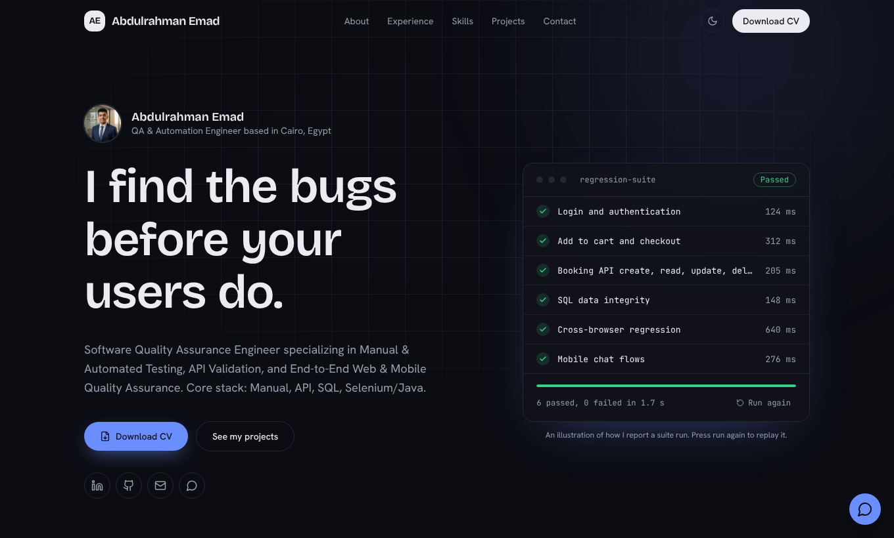
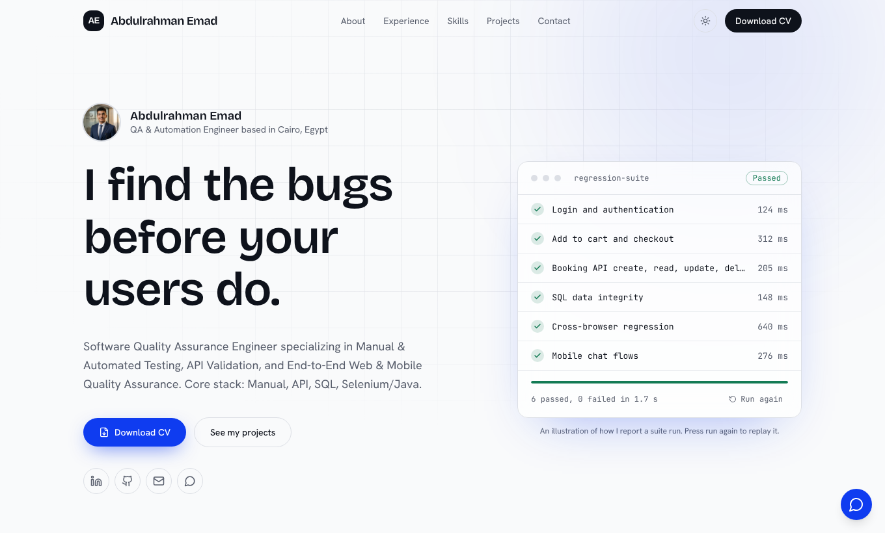
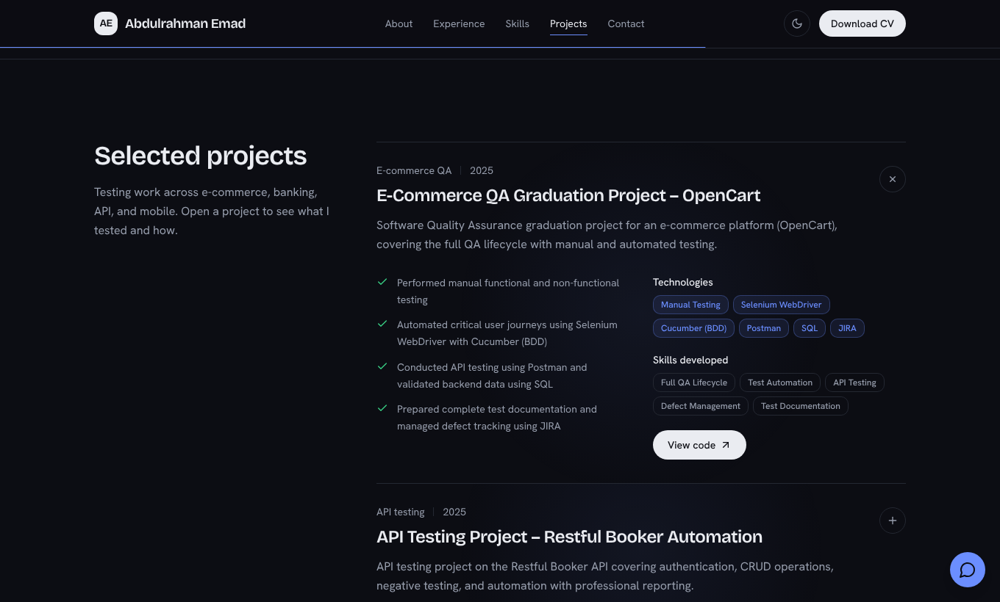

<div align="center">

# Abdulrahman Emad

**QA & Automation Engineer** — Manual, API, SQL, Selenium/Java

Portfolio website · Cairo, Egypt

[**Live site**](https://abdoemad-portofolio.lovable.app) · [Download CV](public/CV_Abdulrahman_Emad.pdf) · [LinkedIn](https://www.linkedin.com/in/abdulrahmanemadfathy) · [Email](mailto:abdoemadfathy1@gmail.com)




</div>

## About

A personal portfolio that presents my software quality assurance work: projects, experience, skills, and a way to get in touch. The site is built to be fast, accessible, and easy to maintain, with all content kept in one data file.

The hero shows a short animated test run that passes line by line, a small nod to the work behind the site.

## Highlights

- **Light and dark themes.** Follows the system preference by default, with a toggle in the header.
- **Considered motion.** One orchestrated hero sequence, spring-based hover and press feedback, and an expanding project list. Motion tokens live in one file, and the `prefers-reduced-motion` setting is respected.
- **English and Arabic.** The site is available at `/` and `/ar`, with full right-to-left layout, Arabic typography, hreflang tags, and a language switch in the header.
- **Project galleries.** Each project can carry real screenshots, shown as a thumbnail grid with a keyboard-accessible full-screen viewer, plus result bars built from the project's own report numbers.
- **Content separated from UI.** Language-neutral data lives in `src/data/portfolioData.ts`, text for each language in `src/data/locales/`, with matching types, so updating the site never means editing components.
- **Responsive and accessible.** Works from 360 px phones to wide desktops, with visible keyboard focus, semantic landmarks, and accessible names on icon buttons.
- **Working contact form** through EmailJS, plus a copy-email shortcut and a WhatsApp link.
- **Search and share ready.** Metadata in `index.html` and React Helmet, a generated sitemap, and a share-sized portrait for social previews.

<table>
  <tr>
    <td></td>
    <td></td>
  </tr>
  <tr>
    <td align="center">Light theme</td>
    <td align="center">Projects, expandable rows</td>
  </tr>
</table>

## Tech stack

| Area | Tools |
| --- | --- |
| Framework | React 18, TypeScript, Vite |
| Styling | Tailwind CSS, shadcn/ui primitives, CSS variable design tokens |
| Motion | Framer Motion |
| Theming | next-themes |
| Typography | Bricolage Grotesque, Hanken Grotesk, JetBrains Mono, with Readex Pro and Noto Sans Arabic for Arabic (self-hosted via Fontsource) |
| Forms | EmailJS |
| SEO | React Helmet Async, generated `sitemap.xml` |

## Getting started

You need [Node.js](https://nodejs.org) 18 or newer and npm.

```bash
git clone https://github.com/abdoemadfathy/abdoemad-portofolio.git
cd abdoemad-portofolio
npm install
npm run dev
```

The dev server runs at <http://localhost:8080>.

| Command | What it does |
| --- | --- |
| `npm run dev` | Start the development server |
| `npm run build` | Generate the sitemap and create a production build in `dist/` |
| `npm run preview` | Serve the production build locally |
| `npm run lint` | Run ESLint |

## Project structure

```text
src/
├── components/
│   ├── common/          Shared building blocks: Section, Reveal, icons
│   ├── gallery/         Thumbnail grid, lazy lightbox, results bars
│   ├── projects/        Expandable project row and the live CI badge
│   ├── HowIWork.tsx     Process steps and the weak vs strong bug-report sample
│   ├── ui/              shadcn/ui primitives
│   ├── Hero.tsx         Headline and animated test-run panel
│   ├── About.tsx        Intro, numbers, and what I offer
│   ├── Experience.tsx
│   ├── Skills.tsx
│   ├── Projects.tsx
│   └── Contact.tsx
├── data/
│   ├── portfolioData.ts Language-neutral data (links, project meta, screenshots, numbers)
│   └── locales/         en.ts and ar.ts: all readable text per language
├── i18n/
│   └── LanguageProvider.tsx  Merges data with the active language
├── types/
│   └── portfolio.ts     Types for the content above
├── lib/
│   └── motion.ts        Motion tokens, variants, and gesture presets
├── styles/
│   └── theme.css        Light and dark design tokens
└── pages/
    └── Index.tsx        Page composition and page metadata
```

## Updating the content

Language-neutral facts live in [`src/data/portfolioData.ts`](src/data/portfolioData.ts). Everything a visitor reads lives in [`src/data/locales/en.ts`](src/data/locales/en.ts) and [`ar.ts`](src/data/locales/ar.ts), which share one `Content` type, so a missing translation fails the type check.

- **Live CI badge:** a project with `liveRun: true` shows the latest result of its GitHub Actions run. The Swag Labs repo publishes `summary.json` to its `ci-results` branch (`CI_SUMMARY_URL` in `portfolioData.ts`). If the file can't be read the badge says so and never shows a number.
- **Analytics:** the Google tag in `index.html` is already on the page. `src/lib/analytics.ts` sends a few named events (CV download, contact clicks, project opened, language switch, bug found); nothing a visitor types is sent, and everything is a no-op if the tag is blocked.
- **Featured vs more:** projects with `featured: true` are listed first; the rest sit behind "Show more projects".
- **Add a project:** add an entry to `projectsMeta` (category, technologies, screenshots, optional results), then add its text under `projects.items` in both locale files.
- **Add screenshots:** save a full-size and a 640 px thumbnail as `public/media/<id>.webp` and `<id>-thumb.webp`, list them in the project's `media`, and add captions in both locale files.
- **Change contact details or links:** edit the `contact` object.
- **Change skills, services, or experience:** edit the matching section in each locale file.
- **Replace the CV:** overwrite `public/CV_Abdulrahman_Emad.pdf`.

Client work under NDA is shown anonymised and only with aggregate numbers. Keep client names, source documents, and private data out of `public/`.

## Design and motion

- **Colors** are HSL tokens in [`src/styles/theme.css`](src/styles/theme.css), defined for both light and dark. Change a token once and the whole site follows.
- **Motion** is defined in [`src/lib/motion.ts`](src/lib/motion.ts): a soft ease-out for entrances, springs for interaction, a 0.08 s stagger between siblings, and a 15 px reveal distance. Animations run once and never loop.
- **Reduced motion** is honored globally through Framer Motion's `MotionConfig`.

## Deployment

The site is a static Vite build, so it can be hosted anywhere that serves static files.

1. Run `npm run build`.
2. Publish the `dist/` folder, or connect the repository to a host such as Vercel, Netlify, or Cloudflare Pages with `npm run build` as the build command and `dist` as the output directory.

The current live site is published through [Lovable](https://lovable.dev), which stays in sync with the `main` branch of this repository.

## Contact

**Abdulrahman Emad**, QA & Automation Engineer, Cairo, Egypt

- Email: [abdoemadfathy1@gmail.com](mailto:abdoemadfathy1@gmail.com)
- Phone and WhatsApp: [+20 112 699 8251](https://wa.me/201126998251)
- LinkedIn: [abdulrahmanemadfathy](https://www.linkedin.com/in/abdulrahmanemadfathy)
- GitHub: [abdoemadfathy](https://github.com/abdoemadfathy)
